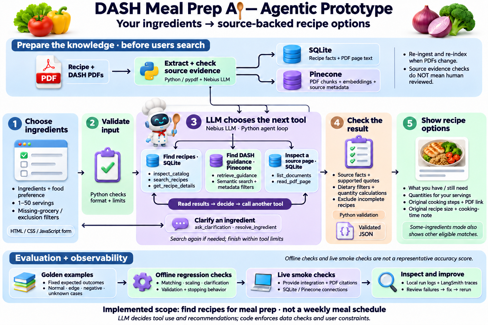
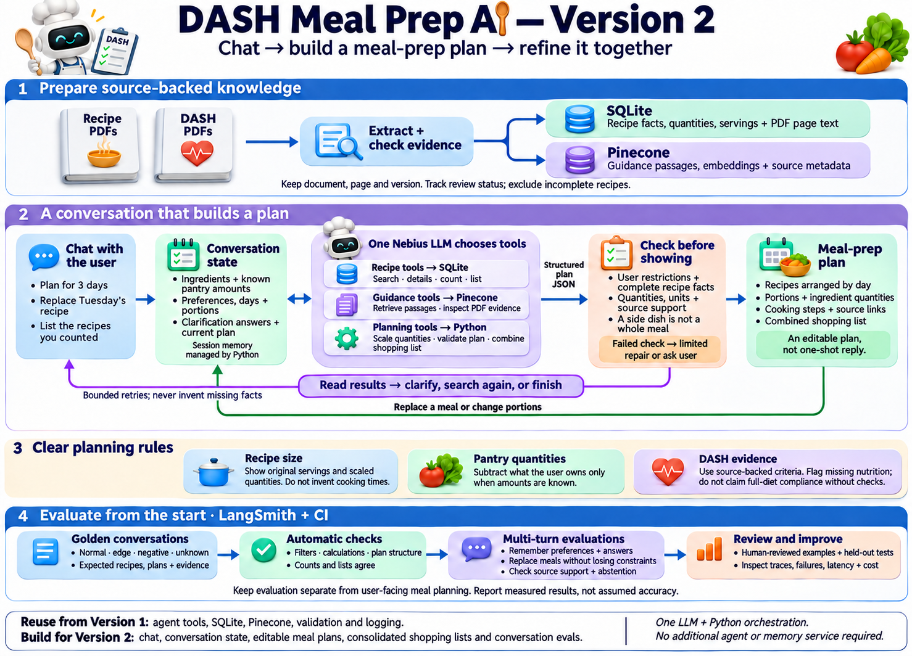

# DASH Meal Prep AI

An agentic recipe-discovery prototype for meal preparation, using recipe PDFs and DASH dietary guidance. Enter ingredients, preferences and portions to find source-backed recipe options.

## What works today

- Browser form with ingredient suggestions, vegetarian preference, exclusions and an optional sodium limit.
- Choose 1–50 portions and either require every ingredient or allow missing groceries.
- A Nebius-hosted LLM selects tools, interprets ingredient wording, asks clarification questions and recommends recipes.
- SQLite provides extracted recipe facts and PDF page text. Pinecone provides semantic retrieval of guidance passages with metadata filtering.
- Python validates restrictions, source references and ingredient calculations. Incomplete recipes are excluded from results.
- Recipe cards show available/missing ingredients, scaled quantities, original cooking steps and PDF links.
- Original serving sizes remain visible. Cooking times are not recalculated for larger quantities.

The prototype finds recipes; it does not yet create a complete weekly meal plan or certify full-diet DASH compliance. Ingredient matching checks names, not quantities available at home. Exclusions are not an allergy guarantee.

## Implemented architecture



PDF preparation runs before user searches: Python/pypdf and the LLM extract records, verify source-text evidence, and store them in SQLite. PDF passages are chunked, embedded and indexed in Pinecone. Re-run ingestion and indexing when source documents change.

During a request, the LLM chooses a tool, reads its result, and decides whether to clarify, retrieve more information or finish. Python enforces restrictions and finite budgets. In partial-match mode, other eligible matches appear after the agent's recommendations.

## Requirements

- Python 3.12 and the dependency in `requirements.txt`.
- Nebius API access to a chat model supporting tool calls/JSON output and an embedding model.
- A Pinecone dense-vector index whose dimension matches the selected embedding model.
- The two official NHLBI DASH PDFs included in `source_pdfs/`.
- Optional LangSmith credentials for tracing.

The app uses standard-library HTTP adapters; provider SDKs are not required. Live extraction, embeddings and model calls may incur provider charges. This is a local demonstration server, not a hardened public hosting service.

## Setup

Run commands from the repository root.

```sh
python -m venv .venv
```

Activate the environment:

```powershell
# Windows PowerShell
.\.venv\Scripts\Activate.ps1
```

```sh
# macOS / Linux
source .venv/bin/activate
```

Install the dependency:

```sh
python -m pip install -r requirements.txt
```

Copy `.env.example` to `.env`, then fill in your own values:

| Setting | Purpose |
| --- | --- |
| `NEBIUS_API_KEY` | Nebius credential |
| `NEBIUS_MODEL` | Chat/tool-calling model identifier |
| `NEBIUS_EMBEDDING_MODEL` | Embedding model identifier |
| `NEBIUS_BASE_URL` | Nebius API endpoint; default provided |
| `PINECONE_API_KEY` | Pinecone credential |
| `PINECONE_INDEX_HOST` | Your index host |
| `PINECONE_API_VERSION` | API version used by the adapter |
| `LANGSMITH_API_KEY` | Optional trace credential |
| `LANGSMITH_ENDPOINT`, `LANGSMITH_PROJECT`, `LANGSMITH_WORKSPACE_ID` | Optional tracing configuration |

Never commit `.env`. The supplied template contains no credentials.

The approved source PDFs are already included in `source_pdfs/`. Build your local SQLite catalog and your own Pinecone index, then start the app:

```sh
python scripts/ingest_pdfs.py --folder source_pdfs
python scripts/index_guidance.py
python app.py
```

Open **http://127.0.0.1:8767/**. On Windows, `START.ps1` can also launch the prepared app.

The source PDFs are included; credentials and generated databases are not. A fresh checkout requires your own API configuration and the preparation steps above. There is no hidden fallback recipe dataset. Keep `source_pdfs/` available for recipe source links. Extraction can vary between runs; inspect `reports/ingestion.json` and retry ingestion for failed pages. Recipes with missing preparation details are excluded. Do not treat a successful ingestion process exit alone as proof that every recipe was extracted.

## LLM prompts and tools

| File | Purpose |
| --- | --- |
| `prompts/agent_system_v1.txt` | Runtime decisions and constraints |
| `prompts/tools_v1.json` | Callable tool schemas |
| `prompts/extract_recipes_v1.txt` | Extract recipe facts from supplied PDF text |
| `prompts/review_extraction_v1.txt` | Check recipe candidates versus menu entries |

Tools include `inspect_catalog`, `resolve_ingredient`, `ask_clarification`, `search_recipes`, `get_recipe_details`, `retrieve_guidance`, `list_documents`, `read_pdf_page` and `finish`. The LLM chooses when to use them; their storage connections and validation are implemented in Python.

## Evaluation

Run offline tests without credentials or production PDFs:

```sh
python -m unittest discover -s tests -v
python scripts/agent_evaluate.py
```

Tests use isolated fixtures in `tests/fixtures/`; these are never production recipe knowledge. Controller tests use scripted model replies and test tool enforcement, clarification, arithmetic and stopping behavior. GitHub Actions runs the offline checks.

After configuring providers and preparing the corpus, optionally run:

```sh
python scripts/agent_evaluate.py --live
```

This performs a small integration smoke suite, not a representative accuracy benchmark. Reports and runtime logs are generated under `reports/`, excluded from Git. LangSmith tracing is optional and sends configured traces to that service.

`data/golden_cases.json` and `scripts/evaluate.py` retain a small, assistant-authored legacy regression benchmark. Its 50% happy-path, 30% edge, 15% known-failure and 5% adversarial mix describes scenario coverage, not expected pass rates. It is not independently labelled evaluation of the current PDF corpus. Precision, recall and F1 from that benchmark measure recipe selection only, not full RAG accuracy.

Extraction is automated and can misinterpret source text. Verbatim citation checks establish traceability, not a guarantee of semantic or nutritional correctness. Independent human-reviewed end-to-end evaluation remains future work.

## Version 2: target design



Planned additions are a chat interface, conversation state, multi-day meal-plan creation and revisions, consolidated shopping lists, and multi-turn evaluations. These features are not implemented in this prototype. Existing clarification state is not a general chatbot memory.

## Public repository contents

Included: application code, prompts, browser interface, portable launcher, dependency file, offline tests and fixtures, golden cases, evaluation scripts, CI workflow, two architecture images, and the two original NHLBI DASH PDFs with attribution and source URLs.

Excluded: real keys, `.env`, other source PDFs, extracted databases, generated reports/logs, local editor settings, environments, caches, development notes and older diagrams. Do not publish provider credentials or private source material in issues or commits.

## Source publications and reuse

Source: National Heart, Lung, and Blood Institute; National Institutes of Health; U.S. Department of Health and Human Services.

The original PDFs in `source_pdfs/` are distributed without modification:

- [Your Guide to Lowering Your Blood Pressure With DASH](https://www.nhlbi.nih.gov/sites/default/files/publications/06-4082.pdf)
- [A Week With the DASH Eating Plan](https://www.nhlbi.nih.gov/sites/default/files/publications/WeekOnDASH.pdf)

See `source_pdfs/ATTRIBUTION.txt` and `source_pdfs/sources.json` for provenance. NHLBI's [reuse policy](https://www.nhlbi.nih.gov/about/contact/trademark-branding-and-logo) permits reuse of most materials, subject to stated exceptions, unchanged publications, attribution, and no implied endorsement. This application is not affiliated with or endorsed by NHLBI or NIH. Their logos are not application branding. Any source-specific restrictions remain applicable.

Recipe cards and scaled quantities are application-generated interpretations; the linked source PDFs remain unchanged. No third-party cuisine compilations are included.
